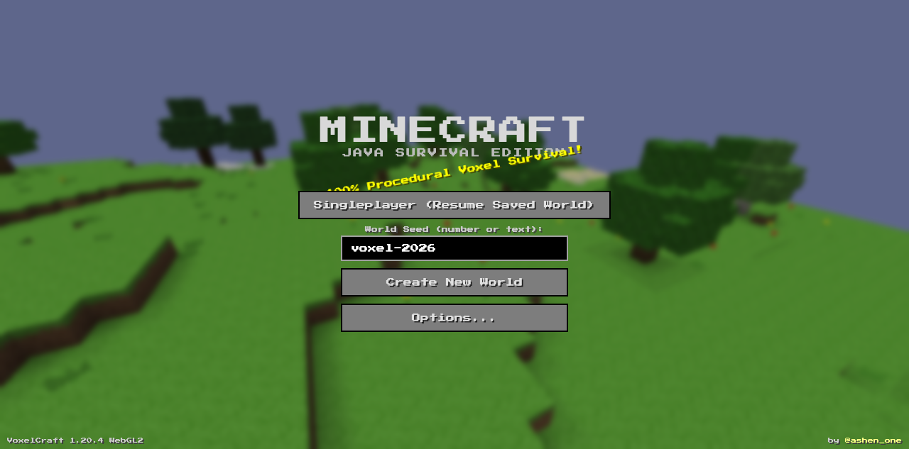
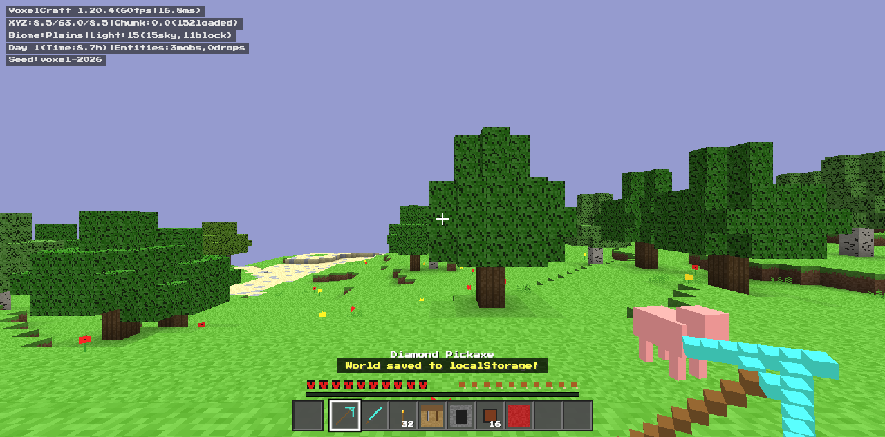
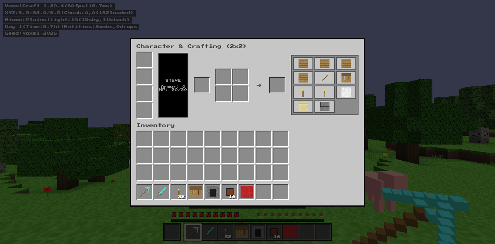
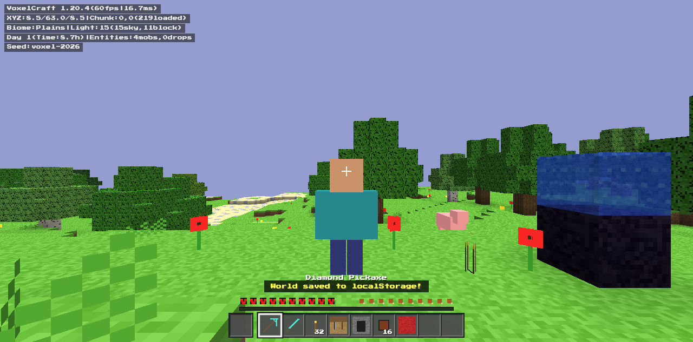

# VoxelCraft — browser voxel survival game

A single-file, procedurally generated voxel survival game in the style of Minecraft Java Edition,
written in plain JavaScript on top of [Three.js](https://threejs.org/) r128. No build step, no backend:
open `index.html` and play.

Built in one session with Google Antigravity CLI (Gemini).



## Features

- Infinite procedural terrain with biomes, caves, trees and water
- Mining and block placement with a hotbar and full inventory UI
- Crafting table, furnace and chest workflows
- Survival stats: health and hunger
- Day/night cycle, torches for light
- Hostile mobs: zombies, skeletons and creepers
- First-person and third-person camera (F5)
- World save/load in `localStorage`





## Run it

Any static file server works. For example:

```bash
python3 -m http.server 8787
# then open http://localhost:8787
```

Three.js and the fonts load from public CDNs, so the first run needs internet access.

## Controls

| Key | Action |
| --- | --- |
| Click | Lock the pointer; left-click mines, right-click places or uses |
| WASD | Move |
| Space | Jump |
| Shift | Sneak |
| Ctrl or double-tap W | Sprint |
| 1–9, scroll | Select hotbar slot |
| E | Inventory and crafting |
| Q | Drop item |
| F3 | Debug overlay |
| F5 | Toggle third-person view |
| Esc | Close menus / pause |

## Disclaimer

This is a fan-made homage to the voxel survival genre. It is not affiliated with, endorsed by or
connected to Mojang or Microsoft. "Minecraft" is a trademark of Mojang AB.

## License

MIT, see [LICENSE](LICENSE).
